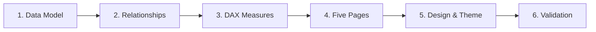

<div align="center">
<h1 align="center"><b>Customer Voice Radar Dashboard (Power BI)</b></h1>
 
**An interactive 5-page Power BI dashboard I designed for a team data challenge — turning customer orders and reviews into insights on complaints, delivery delays, and customers at risk of leaving.**
 


 
</div>
---
 
## Table of Contents
- [About the Challenge](#about-the-challenge)
- [What the Project Contains](#what-the-project-contains)
- [How I Built It](#how-i-built-it)
- [Key Metrics](#key-metrics)
- [Insights](#insights)
- [Dashboard](#dashboard)
- [Skills Demonstrated](#skills-demonstrated)
- [Team](#team)
- [Author](#author)
---
 
## About the Challenge
 
This project was built for **"Data to Impact"**, a specialized challenge in the Data Science & Engineering track of **GDGoC** (Google Developer Groups on Campus). Our team of five worked on one goal: take messy customer data from an online store, analyze it, and turn it into findings and recommendations the business can act on.
 
The work was split into stages — data cleaning, SQL analysis, text analysis, anomaly detection, and the dashboard. **My role was the dashboard:** I designed the data model, wrote the DAX measures, and built the 5-page Power BI report that brings the whole team's results together.
 
## What the Project Contains
 
The store's data came in **8 separate files**. After cleaning, I modeled them into a star schema for Power BI:
 
| Table | Description | Rows |
|---|---|---|
| FactOrders | One row per order: date, status, channel, city, warehouse, delivery days, value, cost | 1,400 |
| FactReviews | One row per review: rating, language, review text, topic, sentiment | 850 |
| ReviewTopics | One row per topic of a review (a review can mention two topics) | 1,078 |
| DimCustomer | One row per customer, with their Customer Health Score | 501 |
| DimDate | Calendar table | — |
| Anomalies | Every unusual case detected in orders, deliveries, and reviews | 1,328 |
| DataQuality / CleaningLog | Before/after cleaning counts and every cleaning action | — |
 
The dashboard includes:
 
- **5 pages**, each answering one business question
- **31 DAX measures** — sales, late delivery %, complaint cost, revenue at risk, and more
- **Synced slicers** — year, sales channel, and city filter every page at once
- **A custom design** — page backgrounds, a side navigation panel, and a consistent color theme
## How I Built It
 

 
**1. Built the data model** from the team's cleaned files and analysis results, shaped as fact and dimension tables.
 
**2. Created relationships** — customers to orders, reviews, and anomalies; dates to orders; reviews to their topics. The review date relationship is kept inactive so it doesn't conflict with the order date.
 
**3. Wrote 31 DAX measures**, for example:
 
| Measure | DAX |
|---|---|
| Late % | `DIVIDE ( [Late Orders], [Shipped Orders] )` |
| Complaint Cost | `CALCULATE ( [Total Sales], FactOrders[has_complaint] = 1 )` |
| Negative Text % | `DIVIDE ( SUM ( FactReviews[is_negative_text] ), [Reviews] )` |
| Revenue at Risk | `CALCULATE ( SUM ( DimCustomer[revenue_sar] ), DimCustomer[health_band] = "معرّض للخسارة" )` |
 
**4. Designed five pages** that tell one story, in order:
 
| Page | Question | Visuals |
|---|---|---|
| Overview | Where do we stand? | KPI cards, monthly sales line, orders by status (donut), sales by city |
| Voice of Customer | What is the problem? | Complaint topics, sentiment per topic, overall sentiment |
| Root Cause | Why does it happen, and what does it cost? | Late % by city, rating by delivery time, warehouse table |
| Early Warning | Who is about to leave? | Anomalies by type and severity, health score vs revenue, at-risk customer list |
| Data Quality | Can we trust the numbers? | Rows and missing values before/after cleaning, review anomalies, cleaning log |
 
**5. Designed the layout** — custom page backgrounds with a header and side panel for page names and slicers, Amiri font for titles, Segoe UI for numbers, and a navy, teal, and orange theme.
 
**6. Validated the numbers** — every card was checked against the team's Python results, and I found and documented a mismatch with the first SQL results (they had run on the raw files, before discounts).
 
The **Customer Health Score** (0–100) combines four signals per customer:
 
```
Health Score = 30 × Rating + 25 × Review Tone + 25 × On-time Delivery + 20 × Retention
```
 
## Key Metrics
 
| Metric | Value |
|---|---|
| Orders | 1,400 |
| Net sales | 904,636 SAR |
| Customers who ordered | 465 |
| Average rating | 3.82 |
| Late deliveries (more than 6 days) | 23.8% |
| Complaints (rating 2 or less) | 141 |
| Cost of orders with complaints | 97,703 SAR |
| Customers at risk of leaving | 27 (43,193 SAR revenue) |
| Anomalies detected | 1,328 |
 
## Insights
 
- **Delivery is the biggest operational problem** — 23.8% of orders took more than 6 days, rising to 37.1% in Abha and 29.3% in Jazan.
- **Star ratings hide the problem** — ratings barely drop with delays (3.90 vs 3.77), but text analysis shows delivery is the second most common complaint topic after quality.
- **Quality and delivery drive complaints** — 152 and 132 negative mentions, far ahead of packaging, size/returns, and service.
- **27 customers are at risk of leaving**, together worth 43,193 SAR in revenue — a ready contact list for the customer service team.
- **The data itself needs fixing** — 424 reviews are dated before their own order and 303 ratings contradict their review text, so date capture should be fixed in the source system.
## Dashboard
 
### Overview

 
### Voice of Customer

 
### Root Cause

 
### Early Warning

 
### Data Quality

 
## Skills Demonstrated
 
- **Data Modeling** — designing a star schema with fact and dimension tables and active/inactive relationships
- **DAX** — 31 measures using CALCULATE, DIVIDE, DISTINCTCOUNT, and filter context
- **Data Visualization** — matching each chart type to a business question (trends, rankings, shares, comparisons)
- **Interactive Filtering** — slicers synced across all pages through one shared model
- **Dashboard Design** — custom backgrounds, side navigation, typography, and a consistent theme
- **Data Validation** — checking every number against independent calculations and documenting differences
- **Business Thinking** — building the report as a story that ends in actionable recommendations
- **Teamwork** — bringing together the outputs of four teammates into one product
## Team
 
| Member | Role |
|---|---|
| **Wajd Alluhaibi** | Dashboard design (Power BI) |
| Aryam Salem | Data engineering & cleaning |
| Ruba Alomari | SQL analysis |
| Wasan Alotaibi | Text analysis |
| Shahad Alshehri | Quality assurance & report |
 
## Author
 
**Wajd Alluhaibi**
Computer Science Student | Data Analysis & Software Development
 
[](https://www.linkedin.com/in/wajd-al-luhaibi-9194a1396)
 
